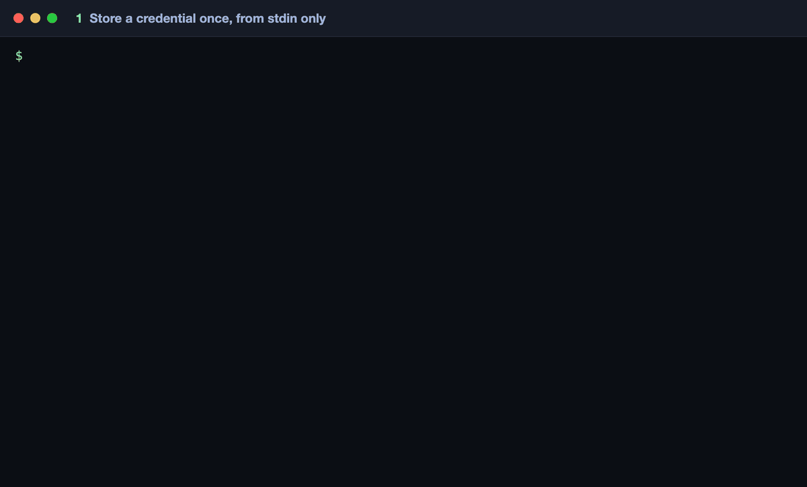
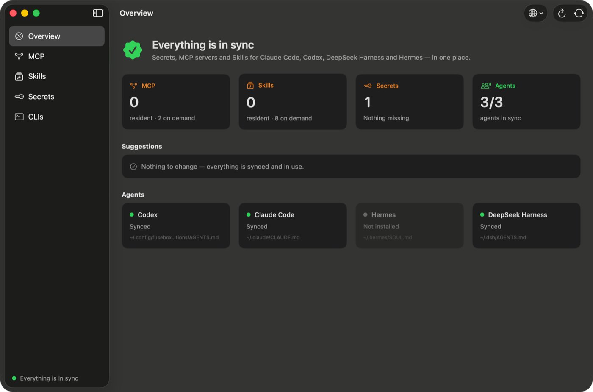

<p align="center">
  <strong>English</strong> · <a href="README.zh-CN.md">简体中文</a>
</p>

<p align="center">
  
</p>

<h1 align="center">Fusebox</h1>

<p align="center">
  <strong>Every MCP server and Skill your AI agents need — on demand, from one place.</strong><br>
  One catalog, one secret store and lazy MCP servers for Claude Code, Codex, DeepSeek Harness, Claude Desktop and Hermes.
</p>

<p align="center">
  <a href="https://github.com/risingjerry/fusebox/actions/workflows/ci.yml"></a>
  <a href="https://github.com/risingjerry/fusebox/releases"></a>
  
  <a href="LICENSE"></a>
  <a href="https://github.com/risingjerry/fusebox/stargazers"></a>
</p>

<p align="center">
  
</p>

Install a hundred Skills and a dozen MCP servers and every agent session pays
for all of them: descriptions fill the context window, MCP processes sit
running, and each agent keeps its own copy of the config and the API keys.

Fusebox gives every MCP server and Skill one of two states:

- **Resident** — loaded in every session, because you asked for it.
- **On demand** — everything else. Agents see the name, find it when a task
  needs it, load it, and the MCP process stops again when idle.

It writes each agent's native config from one registry, keeps secrets in one
file that only the MCP that declares a key can read, and measures from your own
sessions what gets used.

## Install

```bash
# macOS: CLI + app
brew install risingjerry/tap/fusebox
brew install --cask risingjerry/tap/fusebox

# any platform with Rust (CLI; the app needs macOS + Xcode)
git clone https://github.com/risingjerry/fusebox && fusebox/scripts/install.sh
```

Then:

```bash
fusebox doctor                     # what it found and what it would write (writes nothing)
fusebox skills add-source my-skills --path ~/.claude/skills-src   # or --git URL
fusebox mcp add github --command npx --arg -y --arg @example/github-mcp@1.2.3 --secret GITHUB_TOKEN
printf %s "$TOKEN" | fusebox secret set --stdin GITHUB_TOKEN   # the value never appears in argv or logs
fusebox reconcile                  # write every agent's config (backups first)
```

New MCP servers and Skills are **on demand** by default. Make one resident
with `fusebox mcp direct ID` or `fusebox skills enable global NAME`.

## What you get

| | |
|---|---|
| **One catalog** | `fusebox find "merge two PDFs"` ranks Skills and MCP servers together, in English or Chinese, favouring what you used in this project. |
| **Lazy MCP servers** | Agents get one `agent-hub` MCP. A server starts on its first call, gets only its own secrets, and stops after 5 idle minutes. Servers with hundreds of tools are listed by name, schemas on request. |
| **Name lists, not walls of text** | Claude Code sees every on-demand Skill by name (`name-only`); the 30 you use most keep a one-line description. Codex and DeepSeek Harness get the same list in their instructions. |
| **One secret store** | `~/.config/fusebox/secrets.env` (0600). Values go in through stdin or a file descriptor, never arguments; each MCP wrapper exports only the keys it declares. |
| **Usage and advice** | `fusebox skills usage` reads Claude Code, Codex and DeepSeek Harness transcripts. `fusebox advise` turns that into concrete commands: what to make resident, what to move to one project, what agents stopped finding. |
| **Measured discovery** | `fusebox eval` replays your real prompt → Skill picks against `find` and keeps a history, so a change that hurts shows up. |
| **macOS app** | A dashboard in English and Chinese. People look; agents make the changes. |

<p align="center">
  
</p>

## Use with Claude Code, Codex and other agents

Install the bundled skill so any agent knows how to drive Fusebox:

```bash
npx skills add risingjerry/fusebox        # or copy skills/fusebox to ~/.claude/skills/
```

Then ask:

- "Find a skill for turning this outline into slides."
- "Which of my Skills and MCP servers are worth keeping resident? Show me, then apply what I approve."
- "Add the Brave Search MCP on demand; I'll paste the key."

Agents call `fusebox find`, `fusebox advise --json` and the hub's
`fusebox_servers` / `fusebox_call` tools. [AGENTS.md](AGENTS.md) is the guide
for agents working on this repository.

## Commands

| Command | What it does |
|---|---|
| `fusebox status` / `doctor` | drift, missing secrets, findings; writes nothing |
| `fusebox reconcile [--dry-run]` | write native configs, wrappers and instructions (with backups) |
| `fusebox find WORDS` | rank Skills and MCP servers for a task |
| `fusebox mcp list\|add\|set\|remove\|import` | manage MCP servers; `mcp hub ID` / `mcp direct ID` switch on demand / resident |
| `fusebox secret set --stdin NAME` · `list` · `delete` | the secret store (names only on output) |
| `fusebox skills add-source\|fetch\|enable\|disable\|move\|drop\|restore` | Skill sources and states |
| `fusebox skills usage` · `advise` · `eval` | what is used, what to change, how well `find` works |

Every read command takes `--json`. Full help: `fusebox --help`.

## How it works

```
             fusebox reconcile
config.json ───────────────────▶ ~/.claude.json, ~/.claude/settings.json, ~/.claude/skills
secrets.env                      ~/.codex/config.toml + AGENTS.md
Skill Hub                        ~/.dsh/cordis.patch.yml + AGENTS.md, Claude Desktop, Hermes

agent ──▶ agent-hub (one stdio MCP) ──first call──▶ wrapper ──▶ MCP server (own secrets only)
                                     ◀──idle 5 min── stop
```

- Fusebox owns only `agent-*` MCP entries and its own marked instruction
  blocks; everything else in those files is preserved.
- Skills live in a Skill Hub (default `~/.config/fusebox/skill-hub`; set
  `skillHub` in `config.json` or `SKILL_HUB_HOME` to use another) with locked
  git sources and per-project profiles.

## Does on demand pick worse than loading everything?

Not in our measurement. On 112 real prompts where an agent loaded a Skill, a
model shown only names picked the right Skill in its top 3 as often as one
shown every full description; names plus a one-line description for the 30 most
used did better (53% vs 47–48%, two runs each) at a third of the size.
Run `fusebox eval` to measure `find` on your own sessions.

## FAQ

**How do I stop MCP servers from filling Claude Code's context?**
Put them behind `agent-hub` (`fusebox mcp hub ID`, the default for new ones).
Claude Code sees the hub's tools by name and loads definitions only when used.

**How do I share one set of MCP servers between Claude Code and Codex?**
Add each server once with `fusebox mcp add`; `fusebox reconcile` writes both
configs. Both reach every on-demand server through the hub.

**Where are my API keys stored? Can an agent read them?**
In `~/.config/fusebox/secrets.env` (mode 0600). Native configs only reference
a wrapper; the wrapper exports only the keys that server declares. Agents see
key names, never values.

**How do I find which Skills I never use?**
`fusebox skills usage --days 60` and `fusebox advise`.

**Does it work on Linux or Windows?**
The CLI builds and passes CI on Linux; the app is macOS only. Windows is untested.

**Is the app signed?**
Ad-hoc signed, not notarized (no Apple Developer ID yet). The Homebrew cask
removes the quarantine flag and says so. Build from source if you prefer.

## Uninstall

```bash
brew uninstall --cask fusebox; brew uninstall fusebox   # or delete ~/.local/bin/fusebox
```

Your agents' configs keep working until you remove the `agent-*` entries;
backups of every file Fusebox changed are in `~/.config/fusebox/backups`.

## Limits

- Remote (HTTP/SSE) MCP servers are not managed yet; Fusebox leaves them untouched.
- Codex has no names-only Skill mode, so Fusebox lists on-demand names in its instructions.
- The hub does not forward server-to-client requests (sampling, elicitation).

---

If Fusebox saved your context window, a ⭐ helps others find it.

[](https://star-history.com/#risingjerry/fusebox&Date)

MIT © risingjerry · Previously named Agent Switch.
